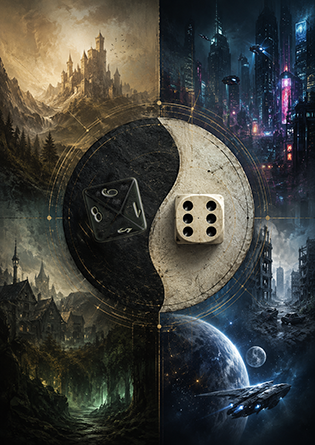

# OmniCore_86RPG_System  
**A modular C++20 engine for tabletop role‑playing games.**

OmniCore_86RPG_System est un moteur de jeu de rôle (TTRPG Engine) développé en **C++20**, conçu pour fournir un noyau logiciel **modulaire**, **extensible** et **documenté**, permettant d’implémenter le système de jeu **8/6 Dystopie** et ses univers dans une architecture commune.

> « *OmniCore_86RPG_System est un moteur logiciel modulaire destiné à modéliser des univers ludiques, leurs entités, leurs règles et leurs interactions.* »  


---

## 1. Présentation

**8/6 Dystopie** est un système de jeu de rôle générique reposant sur un jet unique **1D6 + 1D8**, combinant Avantage/Désavantage (D6) et Destin (D8).

> « *8/6 Dystopie repose sur un seul jet de base, quelle que soit l’action : la somme de 1D6 + 1D8.* »  


Le projet poursuit une double ambition :

1. **Moteur de règles générique**  
   Indépendant des univers, des interfaces et du stockage.
2. **Démonstrateur technique C++ / DevOps**  
   Architecture propre, Domain‑Driven Design, tests, documentation, CI/CD.
---



---

## 2. Vision

OmniCore adopte une approche **data‑driven** :  
le moteur implémente les mécanismes, les univers sont décrits par des données externes (JSON/CSV).

> « *Le moteur ne connaît pas les univers. Les univers ne connaissent pas le moteur.* »  


> « *Les univers de jeu sont décrits dans des fichiers externes (JSON, CSV).* »  


Le moteur constitue la **source unique de vérité métier**, indépendante de toute interface utilisateur.

---

## 3. Objectifs

### Développement logiciel
- C++20 moderne  
- Architecture en couches (Domain / Services / Infrastructure)  
- Domain‑Driven Design  
- Data‑Driven Design  
- UML & documentation  
- Tests unitaires  
- CMake  
- Git / GitHub

### Game Design
- Système simple, modulaire, narratif  
- Adaptable à différents univers (médiéval, horreur, cyberpunk, SF…)

---

## 4. Architecture

> « *Séparation stricte Domaine / Infrastructure / Interface, pour que le moteur de règles reste testable et portable.* »  


### 4.1 Vue d’ensemble

```
86 RPG Builder (Desktop • Web • Mobile • Cloud)
        │
        ▼
OmniCore 86 RPG System
        │
        ▼
JSON • CSV • Save Files
```

### 4.2 Sous‑systèmes

- Catalog System  
- Character System  
- Creature System  
- Equipment System  
- Template System  
- Rule Engine  
- Validation Engine  
- Persistence  
- Serialization  
- Repository

> « *Chaque sous-système possède une responsabilité clairement définie.* »  


---

## 5. Principes d’architecture

Les principes fondateurs sont définis dans `docs/ArchitecturePrinciples.md`.

### Principes clés

- **Data Driven**  
  Le contenu est défini dans des fichiers externes.
- **Séparation définition / état**  
  `Skill` ≠ `ActiveSkill`, `Item` ≠ `InventoryItem`.
- **Catalogues immuables**  
  Chargés, validés, puis figés (`freeze()`).
- **Identifiants fonctionnels stables**  
  `combat.melee`, `weapon.handgun`, etc.
- **Indépendance du domaine**  
  Le domaine ne connaît ni JSON, ni fichiers.
- **Dépendances orientées**  
  UI → App → Services → Domain → Infrastructure.
- **Composition plutôt qu’héritage**
- **Validation centralisée**
- **Modularité**
- **Extensibilité**
- **Open Source Friendly**

> « *Les catalogues constituent la source officielle des données… Les catalogues sont immuables.* »  


---

## 6. Cycle de vie d’un univers

> « *Chargement des catalogues → Validation → freeze() → Le moteur devient opérationnel.* »  


```
Universe.json
    ▼
Repository (Persistence + Serialization)
    ▼
Catalogs
    ▼
Validation
    ▼
freeze()
    ▼
Moteur opérationnel
```

---

## 7. Fonctionnalités (Version 1)

> « *La V1 couvre exclusivement les fonctionnalités de préparation.* »  


### Univers
- Création / modification / duplication  
- Modules de règles  
- Bibliothèques : compétences, spécialisations, équipements, créatures…

### Campagnes
- Création / archivage / suppression  
- PJ, PNJ, créatures  
- Journal de campagne (notes, chronologie, documents)

### Personnages
- Attributs  
- Compétences & spécialisations  
- Équipements  
- Blessures  
- Calculs dérivés  
- Sauvegarde JSON

---

## 8. Roadmap

### Court terme (V1)
- Modèle métier complet  
- Rule Engine (calculs, compétences, dérivés)  
- Validation Engine  
- Persistance JSON/CSV  
- Documentation & UML  
- Tests unitaires

### Moyen terme (V2–V3)
- Jets de dés (1D6+1D8)  
- Combat  
- Battle‑map  
- Comptes utilisateurs  
- Plateforme cloud  
- Application mobile  
- Assistants IA (création de personnages, créatures, équipements)

---

## 9. Arborescence du dépôt

```
OMNICORE_86_RPG
│
├── docs/
│   ├── RPG_Project
│   ├── BookOfRules
│   ├── Specifications
│   ├── Vision
│   ├── Domain
│   ├── ArchitecturePrinciples
│   ├── Architecture
│   ├── Decisions
│   └── Roadmap
│
├── include/
│   ├── Domain/
│   ├── Services/
│   └── Infrastructure/
│
├── src/
│   ├── Domain/
│   ├── Services/
│   └── Infrastructure/
│
├── tests/
├── assets/
├── CMake/
└── README.md
```

---

## 10. Licence

Le moteur est publié sous licence Open Source.  
Les règles de jeu et univers pourront être distribués sous des licences distinctes.

---

## 11. Auteur

Projet conçu et développé par **Jicé**.  
Contributions et discussions bienvenues.

---

